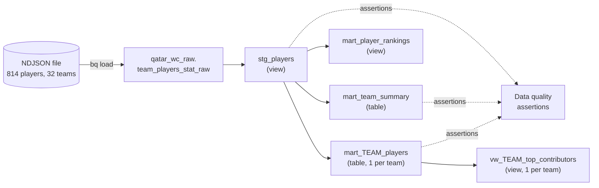
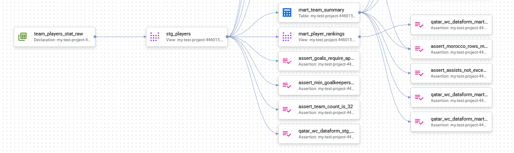
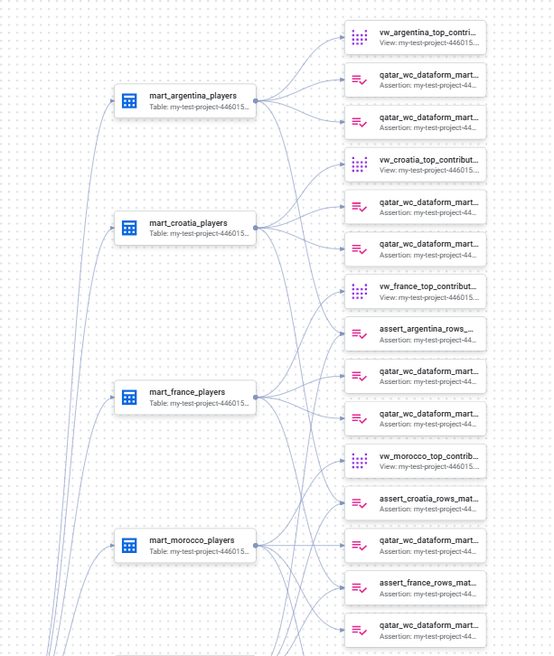

# FIFA World Cup Qatar 2022: ELT pipeline with Dataform

Dataform project that transforms raw player statistics from the FIFA World Cup Qatar 2022 into clean, tested analytical tables in BigQuery: top scorers, goal contributors, team summaries and per-country squad tables.

The goal of the project is to show a complete, production-style ELT workflow: raw ingestion, typed staging layer, analytical marts, data quality assertions and scheduled execution.

**What this achieves:** a messy, string-typed source file becomes trusted analytical tables that anyone can query without knowing the quirks of the original data. The pipeline follows the ELT pattern: data is loaded untouched into BigQuery and every transformation runs inside the warehouse as version-controlled SQL in Git, so the raw data is never lost, every change is reviewable and the whole output can be rebuilt from scratch at any time. Splitting the work into raw, staging and mart layers keeps cleaning rules in a single place and lets each analysis build on data that is already clean, while assertions stop bad data from silently reaching the final tables. Since part of the logic is generated from code, extending it (for example, adding a new team) is a one-line change instead of copy-pasting queries.

## Architecture



| Layer | Dataset | Content |
|---|---|---|
| Raw | `qatar_wc_raw` | Data loaded as-is (almost everything is a string) |
| Output | `qatar_wc_dataform` | Staging view, marts and per-country tables and views |
| Assertions | `qatar_wc_dataform_assertions` | Views generated by Dataform for each assertion |

**Core pipeline** (raw → staging → marts → assertions)



**Per-country objects generated from `team_dynamic.js`**



## What it does

**Staging (`stg_players`)**: casts types and cleans a very dirty source. Cleaning logic lives in reusable JavaScript helpers in `includes/cleaning.js`:

- Four different "missing value" markers (`-`, `N.A`, `N,A` and empty strings) become `NULL`.
- Percentages such as `"46.67%"` become numbers.
- Birth dates arrive in inconsistent formats (`Sept 21, 1988`, `30 October, 2003`, `February 18 1998`) and are normalized before parsing.
- Team and player names are trimmed (some countries have trailing spaces).

**Marts**

- `mart_team_summary`: one row per team with squad size, players used, total goals and assists, average age at kickoff and a `top_scorer` struct.
- `mart_player_rankings`: global and per-position ranks for goals and assists.

**Dynamic per-country objects**: `definitions/marts/team_dynamic.js` loops over the list in `includes/constants.js` (the 4 semifinalists) and generates, for each team, a squad table, a top-5 goal contributors view and a consistency assertion. Adding a team means adding one string to the list.

## Data quality

Assertions are built in layers:

| Type | Where | Examples |
|---|---|---|
| Built-in (`config`) | staging, marts, country tables | `nonNull`, `uniqueKey` / `uniqueKeys`, `rowConditions` (squad size between 24 and 26, valid positions `GK/DF/MF/FW`, FIFA ranking range) |
| Manual SQL (`type: "assertion"`) | `definitions/assertions/` | see table below |
| Generated with JavaScript | `team_dynamic.js` | each country table must match `squad_size` in `mart_team_summary` |

Manual assertions (tagged `data_quality`):

| Assertion | Rule |
|---|---|
| `assert_team_count_is_32` | The tournament has exactly 32 teams |
| `assert_assists_not_exceed_goals` | A team cannot have more assists than goals |
| `assert_goals_require_appearances` | A player with goals must have at least one appearance |
| `assert_min_goalkeepers_per_team` | Every squad has at least 3 goalkeepers |

### Known source data issues

- Serbia lists only 2 goalkeepers in the source. It is excluded in `assert_min_goalkeepers_per_team` with a comment explaining why, so the assertion stays green and still catches new problems.
- Some jersey numbers are duplicated within a team (Portugal 24, Tunisia 26, Serbia 16). There is no assertion for this yet.

## Scheduling

| Resource | Configuration |
|---|---|
| Release configuration `production` | Compiles branch `main`, Mondays 05:00 (`America/Argentina/Cordoba`) |
| Workflow configuration `weekly_full_refresh` | All actions, Mondays 06:00 |
| Workflow configuration `data_quality_only` | Only actions tagged `data_quality`, manual trigger |

Executions run with a dedicated service account (`dataform-runner`), as required when strict act-as checks are enabled.

## Project structure

```
.
├── definitions/
│   ├── sources/
│   │   └── team_players_stat_raw.sqlx       # declaration of the raw table
│   ├── staging/
│   │   └── stg_players.sqlx                 # typed and cleaned view
│   ├── marts/
│   │   ├── mart_team_summary.sqlx
│   │   ├── mart_player_rankings.sqlx
│   │   └── team_dynamic.js                  # per-country tables, views and assertions
│   └── assertions/
│       ├── assert_team_count_is_32.sqlx
│       ├── assert_assists_not_exceed_goals.sqlx
│       ├── assert_goals_require_appearances.sqlx
│       └── assert_min_goalkeepers_per_team.sqlx
├── includes/
│   ├── cleaning.js                          # clean, toInt, toFloat, toPct, toDate
│   └── constants.js                         # list of teams for the dynamic objects
├── schema/
│   └── team_players_stat_raw_schema.json    # BigQuery schema of the raw table
├── docs/
│   ├── dependency_graph_core.png
│   └── dependency_graph_countries.png
└── workflow_settings.yaml
```

## Setup

**Prerequisites**: a Google Cloud project with billing, and the Dataform, BigQuery and Secret Manager APIs enabled.

### 1. Create the datasets (same location for all)

```bash
export PROJECT_ID="your-project-id"
export REGION="us-central1"
export PREFIX="qatar_wc"

bq --project_id=$PROJECT_ID --location=$REGION mk -d ${PREFIX}_raw
bq --project_id=$PROJECT_ID --location=$REGION mk -d ${PREFIX}_dataform
bq --project_id=$PROJECT_ID --location=$REGION mk -d ${PREFIX}_dataform_assertions
```

### 2. Load the raw data

```bash
bq load \
  --project_id=$PROJECT_ID \
  --location=$REGION \
  --source_format=NEWLINE_DELIMITED_JSON \
  --replace \
  ${PREFIX}_raw.team_players_stat_raw \
  ./world_cup_team_players_stats_raw_ndjson.json \
  ./schema/team_players_stat_raw_schema.json
```

Quick check: the table should have 814 rows and 32 distinct teams.

### 3. Configure Dataform

In `workflow_settings.yaml` set your project and dataset names:

```yaml
defaultProject: your-project-id
defaultLocation: us-central1
defaultDataset: qatar_wc_dataform
defaultAssertionDataset: qatar_wc_dataform_assertions
```

Also update `database` and `schema` in `definitions/sources/team_players_stat_raw.sqlx` to point to your raw table.

### 4. Service account for scheduled runs

```bash
SA_EMAIL="dataform-runner@${PROJECT_ID}.iam.gserviceaccount.com"
PROJECT_NUMBER=$(gcloud projects describe $PROJECT_ID --format="value(projectNumber)")
DATAFORM_AGENT="service-${PROJECT_NUMBER}@gcp-sa-dataform.iam.gserviceaccount.com"

gcloud iam service-accounts create dataform-runner --project=$PROJECT_ID

for ROLE in roles/bigquery.dataEditor roles/bigquery.jobUser; do
  gcloud projects add-iam-policy-binding $PROJECT_ID \
    --member="serviceAccount:${SA_EMAIL}" --role="$ROLE" --condition=None
done

for ROLE in roles/iam.serviceAccountUser roles/iam.serviceAccountTokenCreator; do
  gcloud iam service-accounts add-iam-policy-binding $SA_EMAIL \
    --project=$PROJECT_ID \
    --member="serviceAccount:${DATAFORM_AGENT}" --role="$ROLE"
done
```

### 5. Connect the repository and schedule

1. In Dataform, connect the repository to GitHub over HTTPS. The access token is stored in Secret Manager and the Dataform service agent needs *Secret Manager Secret Accessor* on it.
2. Create the release and workflow configurations described in [Scheduling](#scheduling), selecting `dataform-runner` as the service account.

## Possible improvements

- Unit tests (`type: "test"`) for the staging cleaning rules and the team summary aggregations.
- Assertion for duplicated jersey numbers, with the known exceptions documented.
- Range checks in staging (appearances between 0 and 7, percentages between 0 and 100).
- CI/CD with GitHub Actions: compile and validate on every pull request.

## Credits

Inspired by [world-cup-qatar-elt-dataform](https://github.com/tosun-si/world-cup-qatar-elt-dataform) and its accompanying article [ELT with Dataform on Google Cloud](https://medium.com/google-cloud/elt-with-dataform-on-google-cloud-e69fb8484510). The raw dataset comes from that project. The staging cleaning layer, marts, per-country objects and assertions in this repository are my own implementation.
